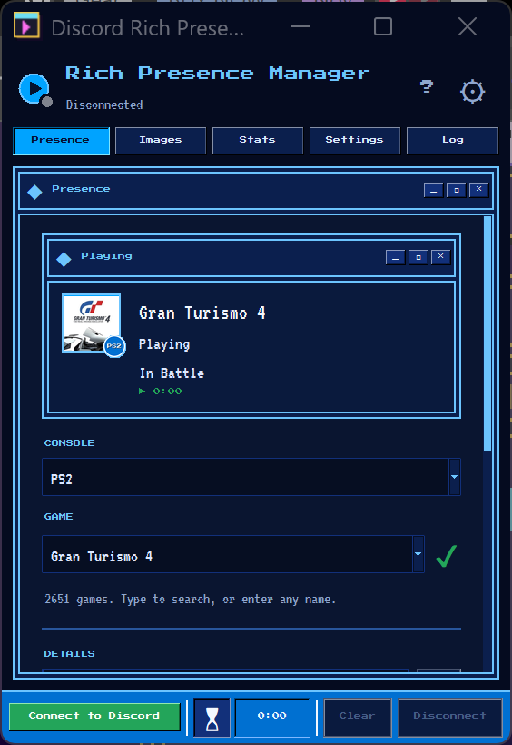
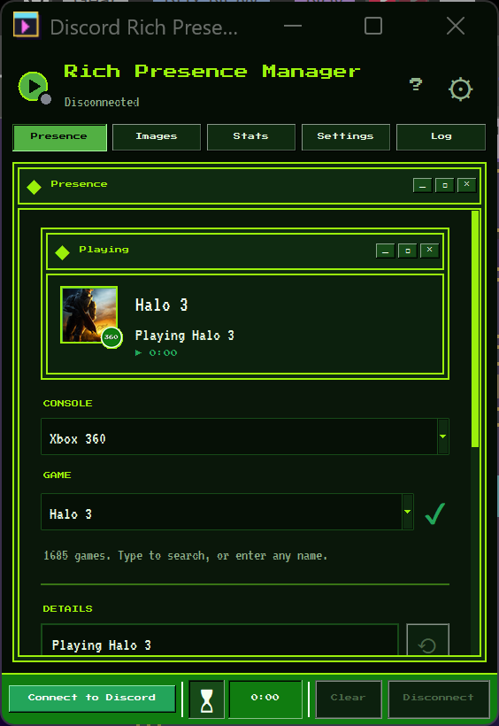
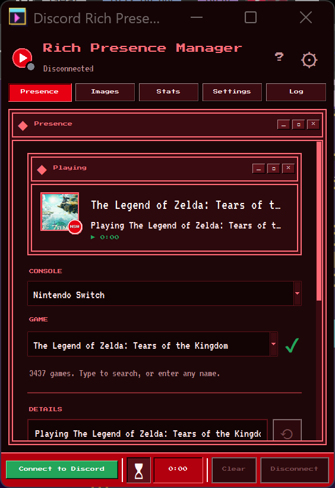
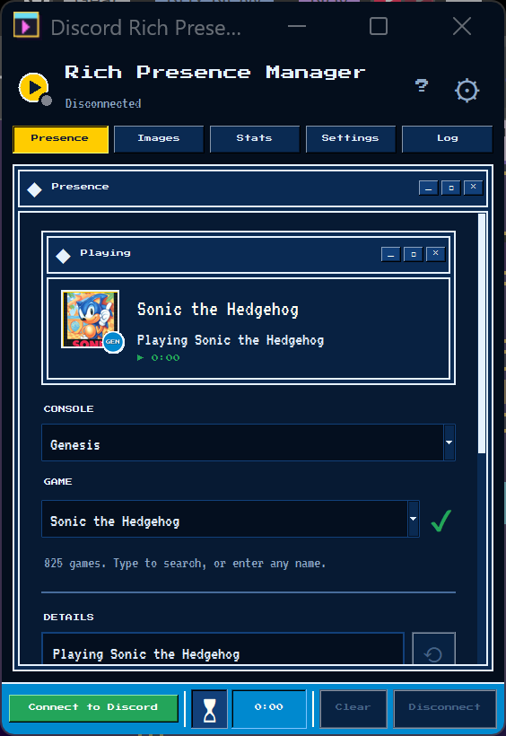
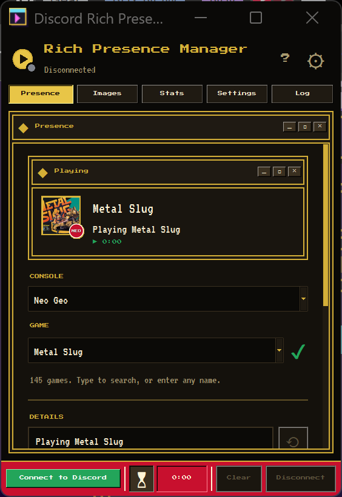
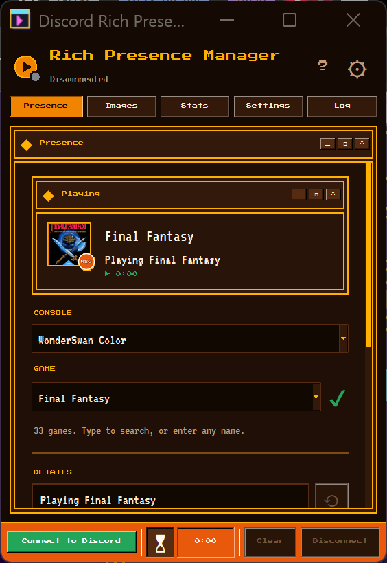
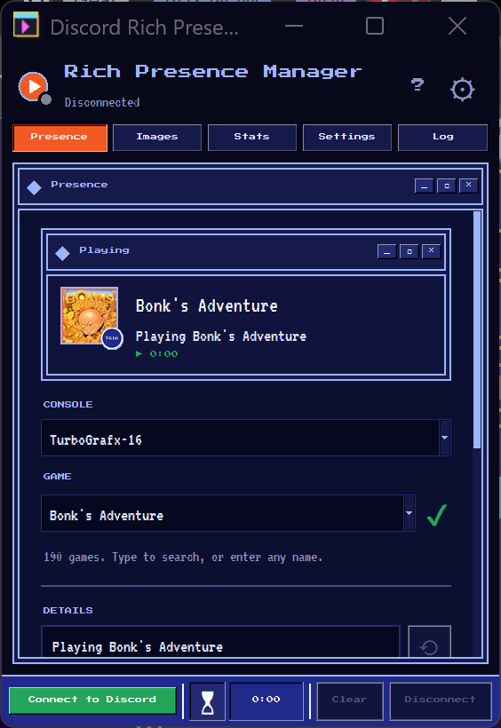

# Discord Rich Presence - Game Selector

A Python application with a graphical user interface (GUI) that allows you to display custom Discord Rich Presence status for video games. The app reads game information from an Excel/CSV database **or Google Sheets** and displays it on your Discord profile.

## Features

- 🎮 **Game Database**: Store multiple games in Excel/CSV or Google Sheets with custom details
- ☁️ **Google Sheets Support**: Load your game database directly from Google Sheets
- 🖥️ **User-Friendly GUI**: Easy-to-use interface built with tkinter
- 🔄 **Real-Time Updates**: Change your Discord status instantly
- ⏱️ **Elapsed Time**: Optional elapsed time display
- 👥 **Party Size**: Show "(1 of 4)" next to your status
- 🔍 **Game Search**: Type to filter your game list, or enter any name
- 📝 **Customizable**: Edit all presence fields directly in the UI
- 💾 **Persistent Config**: Save your Discord Client ID in a config file
- 📊 **Playtime Stats**: Sessions are logged automatically; the Stats tab shows playtime trends, top games and recent sessions
- 🎨 **Console Themes**: The UI recolours itself for PlayStation, Xbox, Nintendo, Sega, SNK, Bandai or NEC when you switch console

## Screenshots

The UI is a retro desktop styled after [the1azreen.neocities.org](https://the1azreen.neocities.org/): bordered windows with title bars, bevelled buttons and a taskbar. The colours follow the console you pick: PlayStation, Xbox, Nintendo, Sega, SNK, Bandai or NEC.

<table>
  <tr>
    <td align="center"><br>PlayStation</td>
    <td align="center"><br>Xbox</td>
    <td align="center"><br>Nintendo</td>
    <td align="center"><br>Sega</td>
  </tr>
  <tr>
    <td align="center"><br>SNK</td>
    <td align="center"><br>Bandai</td>
    <td align="center"><br>NEC</td>
    <td></td>
  </tr>
</table>

## Prerequisites

- Python 3.7 or higher
- Discord Desktop App (must be running)
- Discord Developer Application (for Client ID)

## Installation

1. **Clone the repository**:
   ```bash
   git clone https://github.com/The1Azreen/JustAnotherDiscordRichPresenceApp.git
   cd JustAnotherDiscordRichPresenceApp
   ```

2. **Install required packages**:
   ```bash
   pip install -r requirements.txt
   ```

3. **Set up Discord Application**:
   - Go to [Discord Developer Portal](https://discord.com/developers/applications)
   - Click "New Application" and give it a name
   - Copy the **Application ID** (this is your Client ID)
   - (Optional) Upload custom images under "Rich Presence > Art Assets"

4. **Configure the app**:
   - Open `config.ini` (it will be created from `config.ini.example`)
   - Replace `YOUR_CLIENT_ID_HERE` with your Discord Application ID:
     ```ini
     [Discord]
     CLIENT_ID = 123456789012345678
     ```
    - (Optional) To default to Google Sheets on startup, set in the same file:
       ```ini
       [GoogleSheets]
       USE_GOOGLE_SHEETS = True
       SHEET_URL = https://docs.google.com/spreadsheets/d/YOUR_SHEET_ID/edit
       CREDENTIALS_PATH = credentials.json
       ```

## Windows Exe

To run the app without Python, build a standalone exe:

```bat
build_exe.bat
```

This installs the build tools, then writes `dist\JustAnotherDRP.exe` with the pixel-window icon from `assets\app.ico` (regenerate it with `python tools\make_icon.py`). Put `config.ini` and `games_database.xlsx` (and `credentials.json` if you use Google Sheets) next to the exe; it reads them from its own folder.

## Usage

### Using Local Files

1. **Run the application**:
   ```bash
   python main.py
   ```

2. **Select "Local File" as the database source**

3. **Connect to Discord**:
   - Make sure Discord is running
   - Click the "Connect" button
   - If configured correctly, you'll see "Status: Connected" in green

4. **Select a game**:
   - Choose a game from the dropdown menu
   - The fields will auto-populate with game data from the database

5. **Customize (optional)**:
   - Edit any field to customize your presence
   - Modify details, state, images, etc.

6. **Update your presence**:
   - Click "Update Presence" to apply changes
   - Your Discord profile will now show the custom status!

7. **Clear presence**:
   - Click "Clear Presence" to remove the Rich Presence

### Using Google Sheets

1. **Set up Google Sheets API** (see instructions below)

2. **Run the application**:
   ```bash
   python main.py
   ```

3. **Select "Google Sheets" as the database source**

4. **Enter your Google Sheets URL**:
   - Paste the full URL of your Google Sheet
   - Example: `https://docs.google.com/spreadsheets/d/YOUR_SHEET_ID/edit`

5. **Click "Load"**:
   - The app will load games from your Google Sheet
   - If there are issues, click the help prompt for setup instructions

6. **Continue with steps 3-7 from "Using Local Files"**

### Where to put the Discord Client ID and Google Sheet URL?

- In the app UI:
   - Client ID: Connection section > enter your Client ID in the "Client ID" textbox, then click Connect
   - Google Sheet URL: Game Selection > set Database Source to "Google Sheets" > paste the URL > click "Load"

- In config files (persist between runs):
   - `config.ini` → `[Discord] CLIENT_ID = ...`
   - `config.ini` → `[GoogleSheets] USE_GOOGLE_SHEETS = True` and `SHEET_URL = ...` and `CREDENTIALS_PATH = credentials.json`
   - With these set, the app will prefer the configured defaults; you can still override via the UI.

## Game Database

The game database can be stored in either:
- **Local file**: `games_database.xlsx` (now with multiple sheets)
- **Google Sheets**: A spreadsheet with one tab per console (e.g., PS3, PS4, PS5)

### Database Formats (supported)

1) Wide format (recommended): each row is one game, with these columns:

| Column | Description | Example |
|--------|-------------|---------|
| **Game Title** | Name of the game (shown in dropdown) | Pokemon Red |
| **Details** | First line of Rich Presence | Playing Pokemon Red |
| **State** | Second line of Rich Presence | Exploring Kanto |
| **Large Image** | Image URL or asset key for the large image | https://…/cover.jpg |
| **Large Image Text** | Hover text for large image | Pokemon Red |
| **Small Image** | Image URL or asset key for the small image | https://…/logo.png |
| **Small Image Text** | Hover text for small image | Catching Pokemon |

2) Long format (alternative): use columns `Game Title | Field | Value` and put each field in its own row. Supported Fields: `Details`, `State`, `Large Image`, `Large Image Text`, `Small Image`, `Small Image Text`. The app will pivot this into wide format automatically.

### Multi-Sheet by Console

- Create one sheet/tab per console. For example: `PS3`, `PS4`, `PS5`.
- The sheet name becomes the Console value automatically.
- You can mix formats per sheet (wide or long), the app will normalize.
- Tab names also pick the UI colours:

  | Theme | Tab names that use it |
  |---|---|
  | PlayStation | starting with `PS`, or containing `PlayStation` |
  | Xbox | containing `Xbox` |
  | Nintendo | `NES`, `SNES`, `Nintendo 64`, `GameCube`, `Wii`, `Switch`, `Game Boy`, `DS`, `3DS` |
  | Sega | `SG-1000`, `Master System`, `Genesis`/`Mega Drive`, `Sega CD`, `32X`, `Saturn`, `Dreamcast`, `Game Gear` |
  | SNK | `Neo Geo` |
  | Bandai | `WonderSwan` |
  | NEC | `TurboGrafx`, `PC Engine`, `SuperGrafx`, `PC-FX` |
- To use Google Sheets instead: create a spreadsheet with the same tab names and import each sheet of `games_database.xlsx` into its tab (File > Import in Google Sheets).

### Adding New Games

**For Local Files (Excel):**
1. Open `games_database.xlsx` in Excel
2. Select the console tab (e.g., `PS4`)
3. Add a row with your game information (wide) OR multiple rows (long)
4. Save the file
5. Click "Reload Database" in the app

**For Google Sheets:**
1. Open your Google Sheet
2. Select the console tab to edit (e.g., `PS5`)
3. Add your game(s) using wide or long format
4. Click "Reload Database" in the app (or "Load" if first time)

### Using Custom Images

The "Large Image" and "Small Image" fields accept either:

- **A direct image URL** (easiest): a link straight to a PNG, JPG or GIF, such as box art from `upload.wikimedia.org`. SVG files don't render, and the URL must be under 256 characters. Box art works well for the large image.
- **A console badge** for the small image: `assets/badges/` has a readable pixel badge per console (made by `python tools/make_badges.py`), linked as `https://raw.githubusercontent.com/The1Azreen/JustAnotherDiscordRichPresenceApp/main/assets/badges/<name>.png`. New badges show in Discord once they're pushed to GitHub; the app's preview reads them locally.
- **An Art Asset key**: upload images in the [Developer Portal](https://discord.com/developers/applications) under "Rich Presence" > "Art Assets" (1024x1024 recommended for large, 256x256+ for small), then use the name you gave each image. New assets can take a few minutes to appear; restart Discord if one doesn't show up.

Set hover text in "Large Image Text" and "Small Image Text".

## Google Sheets Setup

To use Google Sheets as your game database, you'll need to set up Google Sheets API access:

### Step 1: Create a Google Cloud Project

1. Go to [Google Cloud Console](https://console.cloud.google.com/)
2. Click "Select a project" > "New Project"
3. Give it a name (e.g., "Discord Rich Presence")
4. Click "Create"

### Step 2: Enable Google Sheets API

1. In the Cloud Console, go to **"APIs & Services"** > **"Library"**
2. Search for **"Google Sheets API"**
3. Click on it and click **"Enable"**
4. Also search for and enable **"Google Drive API"**

### Step 3: Create a Service Account

1. Go to **"APIs & Services"** > **"Credentials"**
2. Click **"Create Credentials"** > **"Service Account"**
3. Enter a name for your service account (e.g., "discord-rpc-app")
4. Click **"Create and Continue"**
5. Skip the optional permissions (click "Continue")
6. Click **"Done"**

### Step 4: Download Credentials

1. Click on the service account you just created
2. Go to the **"Keys"** tab
3. Click **"Add Key"** > **"Create New Key"**
4. Choose **"JSON"** format
5. Click **"Create"** - the file will download automatically
6. Rename the downloaded file to `credentials.json`
7. Place it in the same folder as your application

### Step 5: Prepare Your Google Sheet

1. Create a new Google Sheet or use an existing one
2. Format it with these columns in the first row:
   - `Game Title` | `Details` | `State` | `Large Image` | `Large Image Text` | `Small Image` | `Small Image Text`
3. Add your game data in the rows below

### Step 6: Share the Sheet

1. Open your Google Sheet
2. Click the **"Share"** button (top right)
3. Open your `credentials.json` file and find the **"client_email"** field
4. Copy that email address (it looks like: `your-service-account@your-project.iam.gserviceaccount.com`)
5. Paste it into the share dialog
6. Give it **"Viewer"** or **"Editor"** access
7. Click **"Share"** or **"Send"**

### Step 7: Get Your Sheet URL

1. Copy the full URL from your browser's address bar
2. Example: `https://docs.google.com/spreadsheets/d/1abc123xyz456/edit`
3. You can use either:
   - The full URL, OR
   - Just the sheet ID (the part between `/d/` and `/edit`)

### Step 8: Configure the App

**Option A: Use config.ini**
```ini
[GoogleSheets]
USE_GOOGLE_SHEETS = True
SHEET_URL = https://docs.google.com/spreadsheets/d/YOUR_SHEET_ID/edit
CREDENTIALS_PATH = credentials.json
```

**Option B: Use the GUI**
1. Run the app
2. Select "Google Sheets" radio button
3. Paste your sheet URL
4. Click "Load"

### Troubleshooting Google Sheets

**"Failed to load Google Sheet"**
- Verify the sheet URL is correct
- Make sure you shared it with the service account email
- Check that `credentials.json` exists in the app folder

**"Credentials file not found"**
- Make sure `credentials.json` is in the same folder as `main.py`
- Or update `CREDENTIALS_PATH` in `config.ini` with the correct path

**"Permission denied"**
- The sheet must be shared with the `client_email` from your credentials file
- Check the sharing settings in Google Sheets

**"API not enabled"**
- Make sure both Google Sheets API and Google Drive API are enabled in Google Cloud Console

## Playtime Stats

Every time you update your presence, the app starts logging a play session for that game. The session ends when you switch games, clear your presence, disconnect, close the app, or step away from the PC for longer than `IDLE_MINUTES` (it resumes automatically when you come back).

Open the **Stats** tab to see total playtime, session counts, a playtime chart, your top games and your recent sessions, for the last 7 days, the last 30 days, this month or all time.

**Your history stays private.** It is stored on your machine in your user data folder, not in the project folder, so it can't be committed by accident:

- Windows: `%APPDATA%\JustAnotherDiscordRichPresenceApp\sessions.db`
- macOS: `~/Library/Application Support/JustAnotherDiscordRichPresenceApp/sessions.db`
- Linux: `~/.local/share/JustAnotherDiscordRichPresenceApp/sessions.db`

Set the `JADRPA_DATA_DIR` environment variable to use a different folder.

### How the data flows

```
session_log.py   raw events (start / stop / heartbeat), append-only
      |
pipeline.py      events -> sessions -> daily_playtime  (rebuilt each run)
      |
stats.py         period summaries for the Stats tab
```

The pipeline cleans up the raw events:
- A crash or forced close ends the session at the last heartbeat (written once a minute).
- A gap in heartbeats longer than 3 minutes (PC asleep, app frozen) isn't counted as playtime.
- Sessions shorter than a minute are dropped as mis-clicks.
- Sessions that run past midnight are split across both days.

You can also run it from the command line:

```bash
python pipeline.py                 # rebuild and print a summary
python pipeline.py --csv export/   # also export sessions and daily totals as CSV
```

To try the dashboard with fake data:

```bash
python tools/generate_sample_sessions.py      # writes sample_data/sessions.db
set JADRPA_DATA_DIR=sample_data               # Windows cmd (PowerShell: $env:JADRPA_DATA_DIR="sample_data")
python main.py
```

## File Structure

```
JustAnotherDiscordRichPresenceApp/
├── main.py                 # Main GUI application
├── discord_rpc.py          # Discord Rich Presence handler
├── database.py             # Game database reader (local & Google Sheets)
├── session_log.py          # Logs play sessions to SQLite in your user data folder
├── pipeline.py             # Turns raw session events into sessions and daily totals
├── stats.py                # Stats queries for the Stats tab
├── theme.py                # Retro window theme, brand palettes and custom widgets
├── build_exe.bat           # Builds dist\JustAnotherDRP.exe with PyInstaller
├── assets/app.ico          # App icon
├── assets/badges/          # Console badges used as the Discord small image
├── fonts/                  # Bundled pixel fonts (Press Start 2P, VT323)
├── tools/                  # Icon, badge and sample session data generators
├── tests/                  # Unit tests for the session pipeline
├── docs/screenshots/       # Screenshots used in this README
├── games_database.xlsx     # Local game information database (you provide)
├── credentials.json        # Google Service Account credentials (you provide)
├── config.ini              # Configuration file (create from .example)
├── config.ini.example      # Configuration template
├── requirements.txt        # Python dependencies
├── .gitignore              # Git ignore rules
└── README.md               # This file
```

## Configuration Options

Edit `config.ini` to customize behavior:

```ini
[Discord]
# Your Discord Application ID
CLIENT_ID = YOUR_CLIENT_ID_HERE

[Settings]
# Automatically connect to Discord on startup
AUTO_CONNECT = True

# Keep the elapsed timer running when you apply a different game
KEEP_TIMER_ON_SWITCH = False

# Update interval in seconds (future feature)
UPDATE_INTERVAL = 15

[GoogleSheets]
# Use Google Sheets instead of local file
USE_GOOGLE_SHEETS = False

# Google Sheets URL (full URL or just the sheet ID)
SHEET_URL = 

# Path to Google Service Account credentials
CREDENTIALS_PATH = credentials.json

[Stats]
# End a play session after this many minutes without keyboard/mouse input
# (it resumes when you come back). 0 disables idle detection.
IDLE_MINUTES = 15
```

## Troubleshooting

### "Failed to connect to Discord"
- Make sure Discord Desktop is running
- Verify your Client ID is correct
- Try restarting Discord

### "Import 'pypresence' could not be resolved"
- Run `pip install -r requirements.txt`
- Make sure you're using the correct Python environment

### "Database file not found"
- Make sure `games_database.xlsx` exists in the same folder as `main.py`
- Try creating a new Excel file with the correct column headers

### Images not showing
- For URLs: check the link opens the image itself (not a web page) and isn't an SVG
- For asset keys: use the exact name from "Art Assets" and wait a few minutes after uploading

### Google Sheets not loading
- See the [Google Sheets Setup](#google-sheets-setup) section above
- Make sure the sheet is shared with your service account email
- Verify both Google Sheets API and Google Drive API are enabled
- Check that credentials.json is in the correct location

## Development

### Running Tests

Run the unit tests:

```bash
python -m unittest discover tests
```

Test individual modules:

```bash
# Test database module
python database.py

# Test Discord RPC module (requires valid Client ID)
python discord_rpc.py
```

### Adding Features

Feel free to fork and modify! Some ideas:
- Add support for buttons in Rich Presence
- Auto-detect running games
- Multiple profile presets
- Database editor within the GUI
- Export Google Sheets to local file
- Sync between local and Google Sheets

## Dependencies

- `pypresence` - Discord Rich Presence library
- `gspread` - Google Sheets API wrapper
- `google-auth` - Google authentication library
- `openpyxl` - Excel file support
- `pandas` - Data manipulation
- `tkinter` - GUI framework (included with Python)

## License

This project is open source. Feel free to use and modify as needed.

## Credits

Created by The1Azreen

Built with:
- [pypresence](https://github.com/qwertyquerty/pypresence) by qwertyquerty
- Python's tkinter for the GUI
- pandas and openpyxl for data handling

## Support

If you encounter issues:
1. Check the Activity Log in the app for error messages
2. Verify all configuration steps
3. Make sure Discord is running
4. Check that your Client ID is correct

For more help, please open an issue on GitHub.

## Example

Here's what your Discord profile might show:

```
🎮 Playing Pokemon Red
   Exploring Kanto
   [Pokemon Red Icon]
   Started: 15 minutes ago
```

Enjoy customizing your Discord Rich Presence! 🚀
